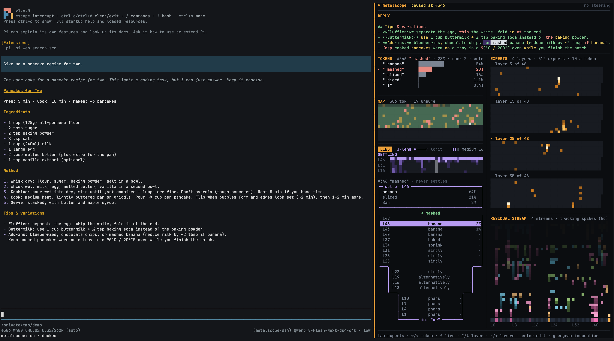

# metalscope

metalscope lets you look inside the language models you run on your own Mac, while they answer you. It hooks into
the local model server itself and records every reply: which experts each token went to, what the model was about to
say at each layer, how sure it was. It can also steer a reply, adding a style such as "joyful" to the model's
inner state on every token, learned from a few dozen example texts and checked in real conversations. You watch it
in the [Pi](https://github.com/earendil-works/pi) coding agent or from the command line.

## What it looks like



**The dock.** Pi with the dock beside it, paused on one token of a pancake recipe. The model wrote "mashed" as its
second choice (28%; "banana" 54%, "sliced" 16%), and the J-lens at layer 46 still read "banana". MAP colours each token by
confidence, LENS shows the word forming layer by layer, TOKENS the five likeliest, EXPERTS which experts fired and
RESIDUAL STREAM where a layer changed the model's state far more than usual.

## Requirements

- A Mac with Apple Silicon and macOS.
- Memory for the model: Qwen3.6 35B at 4 bits is about 20 GB on disk, so a Mac with 32 GB or more. The largest
  models here (Qwen3.8 Flash Next, DeepSeek V4.1 Flash) need 128 GB.
- [uv](https://docs.astral.sh/uv/) to install metalscope (`brew install uv`).
- Python 3.11 or newer (`uv tool install` fetches one; macOS's own `python3` is older).
- A server for the model, one of:
  - [oMLX](https://github.com/jundot/omlx) 0.8.0, 0.8.2, 0.8.3 or 0.8.4 (the versions metalscope is tested with: on
    another, oMLX runs untraced; Inkling 2 needs 0.8.3 or newer). Open oMLX.app once and set an **API key** on its admin page, http://127.0.0.1:8008/admin.
    It serves MLX models, Qwen3.6 among them.
  - [ds4](https://github.com/antirez/ds4) at commit 5379c1c, for Qwen3.8 Flash Next and DeepSeek V4.1 Flash from
    GGUF files. `metalscope ds4 install` fetches that commit and builds it with metalscope's patch (it needs Xcode's
    command line tools: `xcode-select --install`).
    Disk for its models: Qwen3.8 Flash Next Q4 is 165 GiB (about 177 GB), DeepSeek V4.1 Flash Q2 341 GiB (Q4 483 GiB).
    ds4's `download_model.sh` fetches them with Hugging Face's `hf` CLI (`uv tool install huggingface_hub`).
- [Pi](https://github.com/earendil-works/pi), optional but recommended: a live dock beside the chat and
  the `/scope`, `/steer`, `/concept` and `/jlens` commands. It needs [Node.js](https://nodejs.org) (`brew install node`).

## Features

What each one shows, and roughly how. Which model each runs on: [What works on each model](https://github.com/nanastassacos/metalscope/blob/main/docs/backends.md#what-works-on-each-model).

- **Replies and probabilities.** The reply with every token coloured by the probability the model gave it, the ten
  likeliest tokens at each step, and a map of the whole reply to jump to the unsure ones. Read from the model's own
  output at each step.
- **Logit lens.** The word the model would say if it stopped at each layer: that layer's state put through the
  model's own final norm and output head. Needs no setup.
- **Jacobian lens.** The same question answered with a matrix fitted per layer, which reads the middle layers better
  and shows words the model holds but never says. One per model, fitted overnight (`/jlens learn`) or converted from
  a published one.
- **Experts.** On a mixture-of-experts model, which experts each token went to at each layer, recorded from the
  router as it chooses.
- **Residual stream.** How much each layer changed the model's running state at each token, with the spikes marked:
  the places a layer changed it far more than it usually does; or how much each layer changed it for its size.
  On hyper-connection models, each also per stream.
- **Engram inspection.** On a model with an n-gram lookup, a second pass over a finished reply with the lookup
  switched off, to see which tokens it helped.
- **Word swap (experimental).** Change one word of a reply and let the model carry on from there: the new word's
  Jacobian lens direction is pushed into the model's state at that one token.
- **Steering.** A concept such as "pirate" or "calm" added to the model's state at one layer on every token,
  thinking included. A concept is a direction learned on your model from pairs of example sentences, then tried at
  several doses in short chats the model grades itself; the best dose becomes its default. 33 concepts ship, and
  `/concept learn NAME` makes a new one.
- **Sharing.** `concept pack` writes a model's concepts to a folder to upload, like a LoRA adapter; `concept pull`
  places one on a model you serve.

Everything shows live in Pi's dock; the same data is on the command line and over HTTP.

## Quickstart: Qwen3.6 35B on oMLX

In oMLX's admin page, download `lmstudio-community/Qwen3.6-35B-A3B-MLX-4bit`; oMLX serves it as
`Qwen3.6-35B-A3B-MLX-4bit`. Then install metalscope and hook it into oMLX:

```bash
uv tool install metalscope
metalscope omlx install           # the hook oMLX loads when it starts
metalscope omlx restart
metalscope doctor                 # checks every piece
```

The example steers with `joyful`, a concept that ships with its texts. On our Mac its best dose on Qwen3.6 was
0.5: 15 of 18 replies in test conversations were joyful and still made sense.

**With Pi** (`npm install -g @earendil-works/pi-coding-agent` and `metalscope pi install`, then start `pi`):

1. `/model`, pick Qwen3.6-35B-A3B-MLX-4bit (picking it loads it).
2. Chat a few messages. Pi's replies are traced, and steering sizes its doses from those traces (about 2,000
   tokens of replies is enough).
3. Look inside: `ctrl+\` opens the dock beside the chat. Send another message: each token's confidence, lens and
   experts show as the reply is written.
4. `/concept learn joyful`. It learns the vector from the shipped texts in a GPU job (oMLX unloads the model
   meanwhile), then calibrates it in conversation (chat works meanwhile): about half an hour in all on Qwen3.6. The
   widget above the editor shows the steps.
5. `/steer joyful`: every reply from now on is steered at the calibrated dose. After a reply, `/steer replay` shows
   it beside the same message answered unsteered. `/steer off` stops it.

**Without Pi**, the same from the command line:

```bash
metalscope omlx Qwen3.6-35B-A3B-MLX-4bit                     # start oMLX with the model loaded
metalscope on                                                # trace every request
# chat a few messages with any client: doses are sized from those traces
metalscope concept learn joyful Qwen3.6-35B-A3B-MLX-4bit     # learn, then calibrate: about half an hour
metalscope steering on                                       # let requests steer
```

Then any client steers a request with one header (the key is the one you set in oMLX):

```bash
curl http://127.0.0.1:8008/v1/chat/completions -H "Content-Type: application/json" \
  -H "Authorization: Bearer YOUR_OMLX_API_KEY" \
  -H "X-Scope-Steer: joyful" \
  -d '{"model": "Qwen3.6-35B-A3B-MLX-4bit",
       "messages": [{"role": "user", "content": "How was your weekend?"}]}'
```

`concept learn` ends with the chat result and the next command:

```
learned joyful on Qwen3.6-35B-A3B-MLX-4bit: steer layer L12
in chat: 15/18 good @0.5
next: metalscope steering on, then send the header X-Scope-Steer: joyful (in Pi: /steer joyful)
details: metalscope concept show joyful Qwen3.6-35B-A3B-MLX-4bit
```

## How it works

On oMLX, metalscope loads into oMLX's own Python through a small hook file and records
inside the real server, with its batching, prefix cache, speculative decoding and quantisation as they are. On ds4, a
patch to ds4's C and Metal code takes the same readings inside each step, and a proxy in front of it saves them. One
backend serves a model at a time: starting one's model frees the other's. `metalscope on` traces every request, the
`X-Scope-Trace: on` header one request; traces are saved under `~/.metalscope/traces/`.

## Backends

Models metalscope has been run on, per backend (`TESTED` in `models.py`; a test keeps this table the same). A model
counts by its family: on oMLX the checkpoint's config.json `model_type` (as oMLX reads it), on ds4 its GGUF's
architecture (ds4 serves only these). Nothing gates on this list: Pi offers every chat model oMLX reports; one outside
it is marked `untested` in the dock's header (`no` in `metalscope doctor`'s table, `tested: false` in
`/scope/api/status`) and may trace, steer or edit
less well.

| backend | run on |
|---|---|
| oMLX | Qwen3.5 2B, Qwen3.8 27B (MTP), Qwen3.6 35B, Qwen3.8 Flash Next (MTP), Inkling 2 Mini (MTP) |
| ds4 | Qwen3.8 Flash Next, DeepSeek V4.1 Flash |

## Documentation

- [Backends](https://github.com/nanastassacos/metalscope/blob/main/docs/backends.md): install in detail, upgrade and uninstall, who can reach it, oMLX, MTP models, ds4, checkpoints, updating the engines.
- [Front ends](https://github.com/nanastassacos/metalscope/blob/main/docs/dock.md): the live stream, the Jacobian lens, Pi and its dock, traces and their size budget.
- [Steering and concepts](https://github.com/nanastassacos/metalscope/blob/main/docs/steering.md): Pi's `/steer` and `/concept`, the `X-Scope-Steer` header, concept profiles, sharing.
- [Command reference](https://github.com/nanastassacos/metalscope/blob/main/docs/commands.md): the command line, Pi and the dock's keys.
- [Measurements](https://github.com/nanastassacos/metalscope/blob/main/docs/measurements.md): Inkling 2, what tracing costs, the jobs' times, lens fits.
- [Design and development](https://github.com/nanastassacos/metalscope/blob/main/docs/development.md): design rules, layout, development.

## Acknowledgements

- [ds4](https://github.com/antirez/ds4) by antirez (MIT): metalscope's patch modifies it and carries its code.
- [oMLX](https://github.com/jundot/omlx) (Apache-2.0): the server metalscope hooks into.
- Anthropic's Jacobian lens ("Verbalizable Representations Form a Global Workspace in Language Models", 2026, and
  [anthropics/jacobian-lens](https://github.com/anthropics/jacobian-lens)): `jlens/fit.py` reimplements its estimator.
- [Pi](https://github.com/earendil-works/pi) by earendil-works: the coding agent the front end extends.

## Licence

- metalscope is MIT ([LICENSE](https://github.com/nanastassacos/metalscope/blob/main/LICENSE)).
- The ds4 patch applies to antirez's ds4, which is MIT. The patch carries ds4's code, so ds4's licence is copied
  beside it: `src/metalscope/ds4/LICENSE.ds4`. metalscope's own changes in the patch are MIT.
- The concept texts in `src/metalscope/data/concepts` were written by models: Claude (Fable 5.1, Opus 5.5), Qwen3.6
  35B-A3B, Qwen3.8 Flash Next and DeepSeek V4.1 Flash. Each concept's `concept.json` (and `writing.json`, when it
  has one) names its writer. They ship under metalscope's MIT licence.
